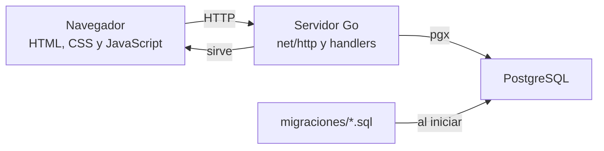

# R-HOPE

> Espacio anónimo de reflexión y acompañamiento sobre el uso excesivo del teléfono celular.
> Componente del **Proyecto Esperanza** ( *R-HOPE*).

---

## Estado actual de la implementación

**Stack:** Go (`net/http` + `pgx`) con PostgreSQL; frontend en HTML/CSS/JS dentro de `static/`.

| Funcionalidad | Estado |
|---|---|
| Registro e inicio de sesión (contraseñas con bcrypt, sesiones por cookie) | Hecho |
| Aviso claro cuando el correo no tiene cuenta (login y recuperar contraseña) | Hecho |
| Bloqueo temporal tras 4 intentos fallidos de login (15 min) | Hecho |
| Recuperar / restablecer contraseña por correo (enlace válido 30 min) | Hecho |
| Publicaciones y comentarios (crear, listar, editar, borrar) | Hecho |
| Filtro de palabras prohibidas y panel de administración | Hecho |
| Antispam y protección CSRF | Hecho |
| Mapa, test y páginas informativas | Hecho |
| Directorio, registro y perfiles de especialistas | Hecho |
| Acompañamiento voluntario y mensajería privada | Hecho |
| Administración de cuentas y solicitudes de especialistas | Hecho |

### Ejecutar en local

1. Instala Go 1.26.8 y PostgreSQL, y crea una base de datos para el proyecto.
2. Copia `.env.example` a `.env` y configura `DATABASE_URL` para esa base de datos. `PORT` es opcional; por defecto se usa `8080`.
3. Ejecuta `go mod download` y luego `go run .`.
4. Abre `http://localhost:8080`. Al iniciar, la aplicación ejecuta automáticamente las migraciones de `migraciones/`.

> Nunca subas `.env` ni el binario compilado: ya están en `.gitignore`.

---

## Tabla de contenidos

- [R-HOPE](#r-hope)
  - [Estado actual de la implementación](#estado-actual-de-la-implementación)
    - [Ejecutar en local](#ejecutar-en-local)
  - [Tabla de contenidos](#tabla-de-contenidos)
  - [Sobre el proyecto](#sobre-el-proyecto)
  - [Objetivos](#objetivos)
    - [Objetivo general](#objetivo-general)
    - [Objetivos específicos](#objetivos-específicos)
  - [Alcance](#alcance)
  - [Arquitectura](#arquitectura)
  - [Requisitos funcionales](#requisitos-funcionales)
  - [Requisitos no funcionales](#requisitos-no-funcionales)
  - [Metodología de trabajo](#metodología-de-trabajo)
  - [Entregables](#entregables)
  - [Aviso importante](#aviso-importante)
  - [Autores](#autores)
  - [Licencia](#licencia)

---

## Sobre el proyecto

El uso excesivo del teléfono celular es cada vez más común, especialmente entre jóvenes y adultos jóvenes, y con frecuencia pasa desapercibido porque no existe un espacio adecuado para reflexionar sobre estos hábitos ni para compartirlos con otras personas en situaciones similares.

**R-HOPE** es una plataforma R-HOPE para reflexionar sobre los hábitos digitales y encontrar espacios de apoyo. En la comunidad, las personas pueden:

- Crear publicaciones y compartir experiencias sin exponer su identidad.
- Formular preguntas relacionadas con el uso del celular.
- Consultar y responder publicaciones de otros usuarios.
- Explorar recursos, realizar un test orientativo y encontrar especialistas verificados.
- Solicitar acompañamiento voluntario y conversar mediante mensajería privada.

El **anonimato** es la característica central del espacio: busca que las personas participen con mayor confianza, sin necesidad de revelar quiénes son.

---

##  Objetivos

### Objetivo general
Mantener una plataforma R-HOPE que permita a las personas reflexionar sobre el uso del teléfono celular, compartir experiencias de forma anónima y consultar recursos de apoyo.

### Objetivos específicos
- Facilitar la creación, consulta y moderación de publicaciones y comentarios.
- Proteger las cuentas y los datos mediante controles de acceso, sesiones y medidas de seguridad.
- Ofrecer recursos preventivos, perfiles de especialistas y opciones de acompañamiento.
- Mejorar la plataforma de forma incremental y mantener información clara sobre su alcance.

---

##  Alcance

**Incluye:**
- Comunidad anónima con publicaciones, comentarios, reacciones y moderación.
- Cuentas de usuario, administración y recuperación de contraseña.
- Directorio, verificación y perfiles de especialistas.
- Mapa, test orientativo y páginas informativas.
- Solicitudes de acompañamiento voluntario y mensajería privada.
- Almacenamiento en PostgreSQL y migraciones de esquema versionadas.

**No incluye:**
- Diagnósticos médicos o psicológicos.
- Sustitución de la atención de profesionales de la salud.
- Terapia o tratamiento de ningún tipo.

> El propósito del foro es exclusivamente **preventivo, educativo y de concientización**: que cada usuario reflexione sobre sus propios hábitos y, si lo considera necesario, busque apoyo profesional por su cuenta.

---

## Arquitectura

La aplicación usa una arquitectura cliente-servidor: las páginas estáticas se sirven desde Go, los handlers atienden las rutas HTTP y `pgx` conecta el backend con PostgreSQL. Las migraciones SQL versionadas se ejecutan al iniciar la aplicación.

| Componente | Responsabilidad |
|---|---|
| **Frontend** | Páginas y recursos estáticos en `static/`; se comunica con el servidor mediante HTTP y JavaScript. |
| **Servidor Go** | Sirve las páginas, registra las rutas y ejecuta la lógica de autenticación, comunidad, administración y acompañamiento. |
| **PostgreSQL** | Guarda cuentas, publicaciones, comentarios y demás datos de la aplicación. |
| **Migraciones** | Los archivos SQL de `migraciones/` actualizan el esquema de forma versionada al iniciar el servidor. |

El flujo principal es: navegador → ruta HTTP de Go → PostgreSQL cuando la operación requiere datos → respuesta al navegador.

---

##  Requisitos funcionales

| ID | Descripción |
|---|---|
| RF01 | Permitir al usuario acceder al foro sin mostrar públicamente su identidad. |
| RF02 | Permitir crear publicaciones anónimas. |
| RF03 | Permitir consultar las publicaciones disponibles. |
| RF04 | Permitir responder a publicaciones existentes de forma anónima. |
| RF05 | Permitir formular preguntas relacionadas con el uso del teléfono celular. |
| RF06 | Validar que los campos obligatorios de una publicación o respuesta estén diligenciados antes de almacenarlos. |
| RF07 | Almacenar las publicaciones y respuestas en la base de datos. |
| RF08 | Recuperar y mostrar las publicaciones almacenadas. |
| RF09 | Aplicar reglas básicas de moderación definidas para el foro. |
| RF10 | Mantener separada la identidad técnica del contenido que se muestra públicamente (diseño de anonimato). |
| RF11 | Permitir organizar las publicaciones para facilitar su consulta. |
| RF12 | Permitir gestionar o moderar contenido que incumpla las reglas establecidas. |

---

##  Requisitos no funcionales

| ID | Categoría | Descripción |
|---|---|---|
| RNF01 | Seguridad | La información almacenada debe contar con mecanismos de protección y control de acceso. |
| RNF02 | Privacidad | La interfaz pública no debe revelar información que permita identificar al participante. |
| RNF03 | Usabilidad | Interfaz sencilla, clara y comprensible para usuarios con distintos niveles de experiencia. |
| RNF04 | Rendimiento | Las consultas y operaciones habituales deben responder en un tiempo razonable bajo la carga prevista. |
| RNF05 | Disponibilidad | El sistema debe estar disponible durante los periodos definidos para su uso. |
| RNF06 | Mantenibilidad | La separación por capas debe facilitar la modificación y mantenimiento de cada componente. |
| RNF07 | Escalabilidad | La estructura debe permitir aumentar usuarios, publicaciones y respuestas sin reconstruir el sistema. |
| RNF08 | Integridad | La información almacenada debe conservar relaciones y consistencia entre usuarios, publicaciones y respuestas. |
| RNF09 | Compatibilidad | La aplicación debe funcionar correctamente en los entornos y navegadores definidos para el proyecto. |
| RNF10 | Recuperación | Deben contemplarse mecanismos de respaldo y recuperación de la información. |

---

##  Metodología de trabajo

El desarrollo se propone bajo **Scrum**, dividiendo el trabajo en *sprints* cortos:

1. Se definen **historias de usuario** ligadas a las funcionalidades principales (crear publicación, responder, consultar contenido, etc.).
2. Cada historia se trabaja dentro de un sprint, desarrollando y probando el foro de forma incremental.
3. Al final de cada sprint se revisa el avance y se incorpora la retroalimentación obtenida al siguiente ciclo.
4. Cada funcionalidad se distribuye entre las tres capas de la arquitectura (presentación, lógica de negocio, datos) a medida que se implementa.

> Ejemplo: al implementar "crear publicación", la capa de presentación aporta el formulario, la capa de lógica de negocio valida el contenido y aplica las reglas de anonimato, y la capa de datos almacena la publicación para su consulta posterior.

---

## Entregables

- [ ] Documento de requisitos del sistema
- [ ] Diseño general de la arquitectura
- [ ] Diseño de la base de datos
- [ ] Interfaz funcional del foro
- [ ] Módulo de publicaciones y respuestas
- [ ] Mecanismos de anonimato y validación
- [ ] Módulo o herramientas básicas de moderación
- [ ] Pruebas funcionales y registro de resultados
- [ ] Manual técnico y manual básico de usuario
- [ ] Código fuente y elementos necesarios para instalación y puesta en funcionamiento

---

##  Aviso importante

Este foro **no realiza diagnósticos médicos ni psicológicos**, **no reemplaza la atención de profesionales de la salud** y **no constituye una terapia ni un tratamiento**. Su finalidad es exclusivamente R-HOPE, educativa y de concientización.

---

##  Autores

Proyecto desarrollado en el marco de **Desarrollo de Software**, Corporación Tecnológica Industrial Colombiana (Teinco), Bogotá, Colombia.

| Nombre | Correo |
|---|---|
| Dilan Pinilla | 1026266591@teinco.edu.co |
| Jean Delgadillo | 1019606357@teinco.edu.co |
| Juan Salcedo | 1013117752@teinco.edu.co |

---

##  Licencia

*Por definir.*

---

<em>Proyecto Esperanza — septiembre de 2026</em>

